# kubejs-modpack-scripts

Scripts em **KubeJS (JavaScript)** que criam receitas personalizadas para um modpack de Minecraft: geração de minérios com a Mesa Vibratória e o Crushing do Create, mercado de plantas, extratores do XyCraft e receitas básicas.

> 🤖 **Aviso:** este projeto foi desenvolvido por mim com o apoio de IAs (Claude e Grok). Eu defini as ideias, guiei a IA, revisei o código e testei no jogo.

---

## 📖 Visão geral

O objetivo é deixar a progressão do modpack mais rápida e flexível, criando fontes de recursos a partir de blocos comuns e blocos comprimidos. Os scripts são organizados por mod:

| Pasta | Arquivo | O que faz |
|-------|---------|-----------|
| `create/` | `Vintage.js` | Sistema de minérios: **Mesa Vibratória** (Vintage Improvements) gera minérios a partir de blocos normais com chance de drop, e o **Crushing do Create** processa blocos comprimidos (1x a 9x) com quantidades que aumentam por nível |
| `farmingforblockheads/` | `market.js` | Adiciona a Aloe Vera (Biomes We've Gone) à categoria de mudas do Market |
| `minecraft/` | `recipes.js` | Receita sem forma: 2 Aloe Vera → 4 Slime Balls |
| `xycraft/` | `recipes.js` | Extractor: Redstone Block cercado por 4 Obsidian gera 4 Flux Dust |
| `xycraft/` | `Sand.js` | Extractor: gera 4 de areia a partir de areia, com Deepslate ao redor |

---

## 🛠️ Tecnologias utilizadas

- **JavaScript** com **KubeJS**
- Mods integrados: Create, Vintage Improvements, AllTheOres, AllTheCompressed, AllTheModium, Powah, Farming for Blockheads, XyCraft, Flux Networks, Biomes We've Gone

---

## ⚙️ Requisitos

- Minecraft: **1.21.1**
- Mod loader: **NeoForge**
- Mod **KubeJS** instalado, além dos mods listados acima

---

## 🚀 Como usar

1. Instale o KubeJS e os mods da lista no seu modpack.
2. Copie as pastas deste repositório para dentro de `kubejs/server_scripts/` do seu modpack:

```
kubejs/
└── server_scripts/
    ├── create/
    │   └── Vintage.js
    ├── farmingforblockheads/
    │   └── market.js
    ├── minecraft/
    │   └── recipes.js
    └── xycraft/
        ├── recipes.js
        └── Sand.js
```

3. Abra o jogo (ou o mundo) e rode o comando `/reload` para carregar as receitas.
4. Verifique erros no arquivo `logs/kubejs/server.log`.

---

## 📸 Demonstração

Capturas das receitas carregadas no jogo (no visualizador de receitas), mostrando que os scripts funcionam.

### Mesa Vibratória

Blocos comuns viram minérios, com chance de drop para cada item.

<p>
  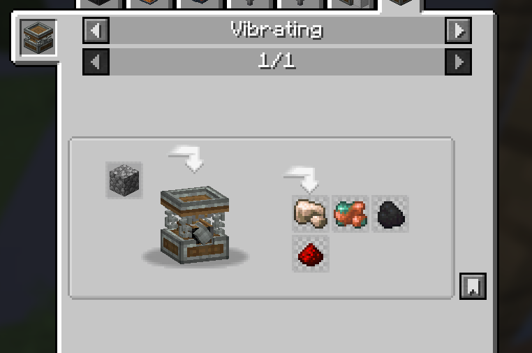
  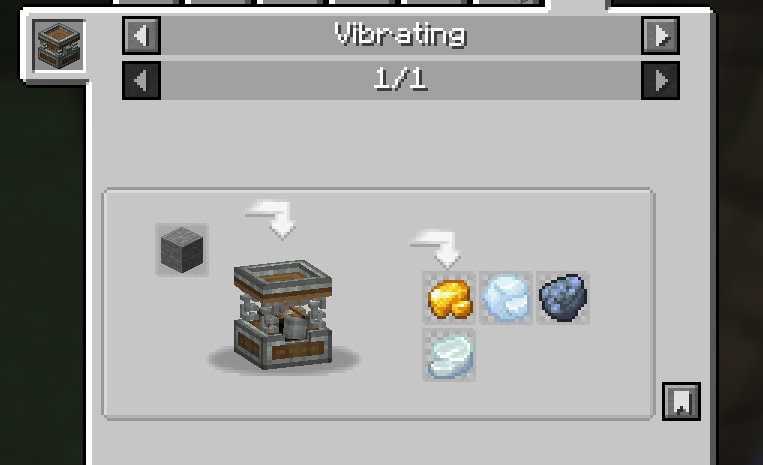
  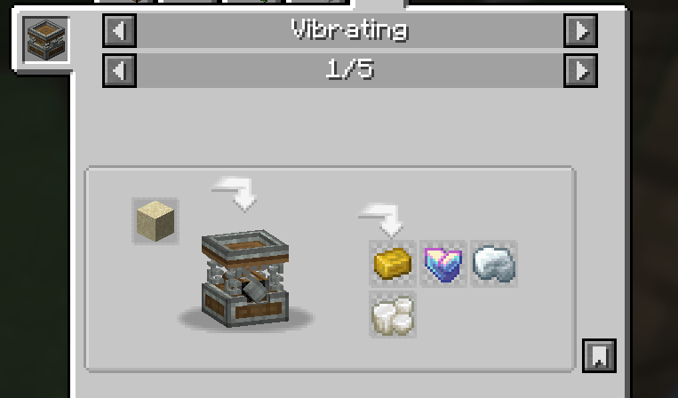
  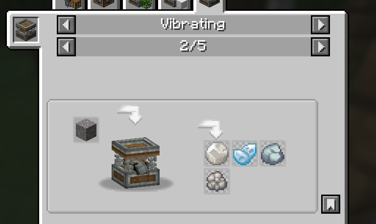
  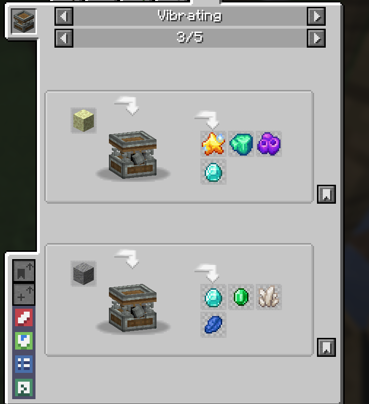
  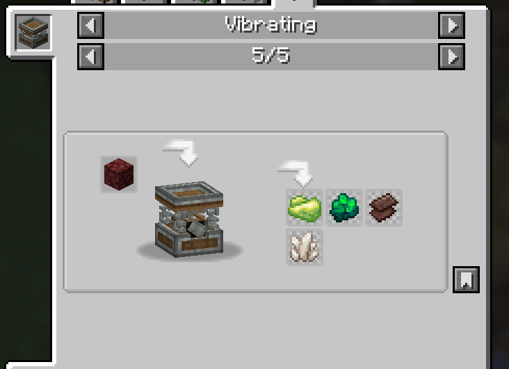
</p>

### Crushing do Create

Blocos comprimidos rendem quantidades maiores de minérios a cada nível.

<p>
  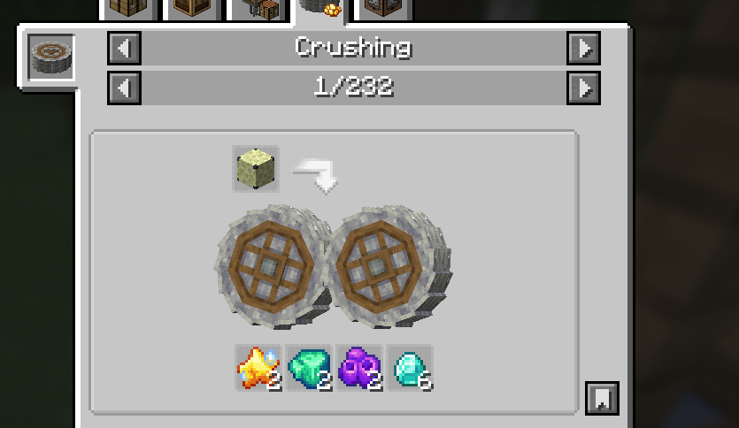
  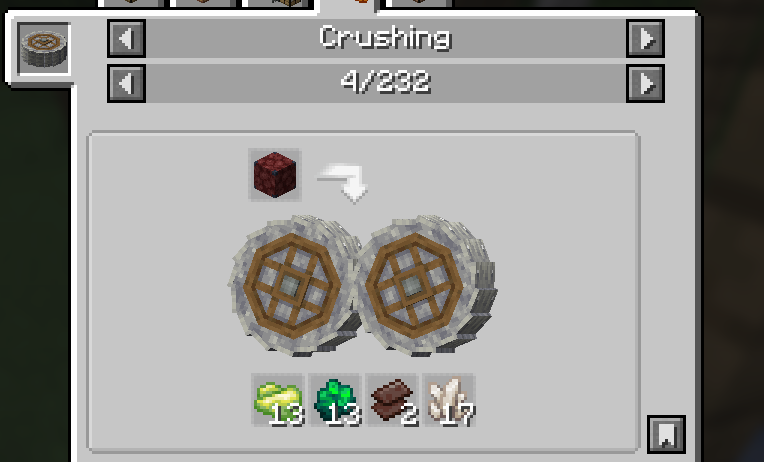
  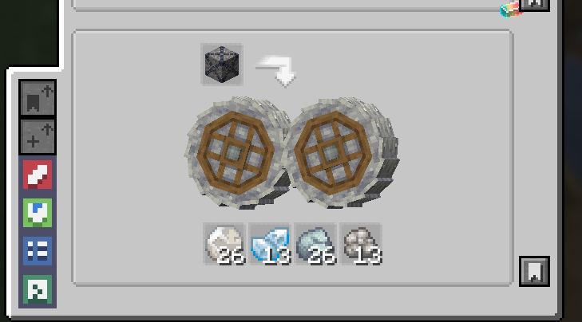
  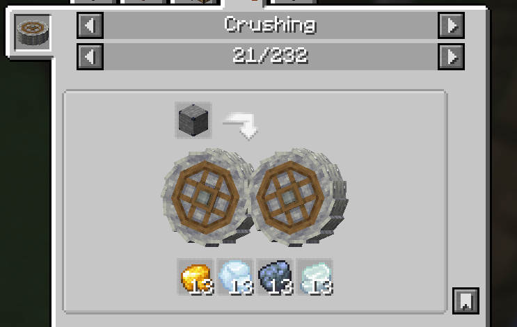
  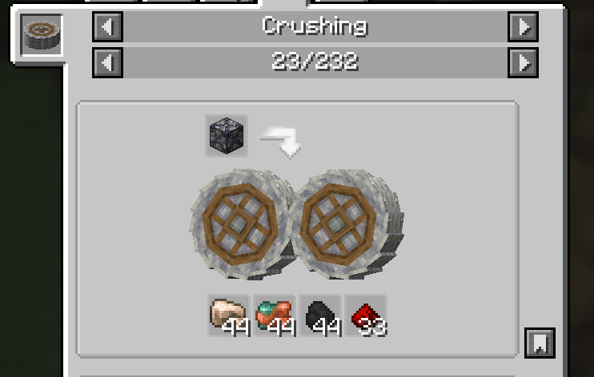
  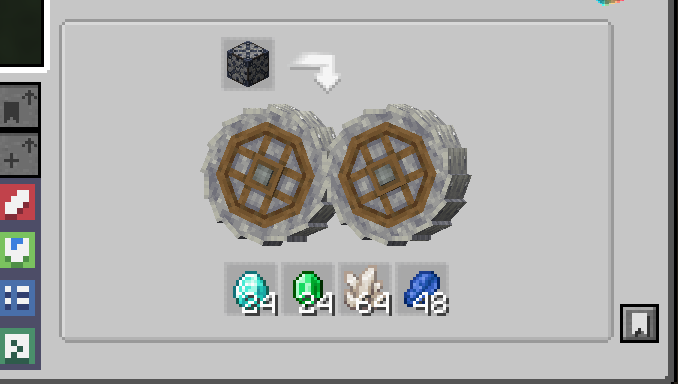
</p>
---

## 📜 Licença

Distribuído sob a licença **MIT**. Veja o arquivo [LICENSE](LICENSE) para mais detalhes.

---

## 👤 Autor

**Tauan Dias**
💼 [LinkedIn](https://www.linkedin.com/in/tauan-dias-1b078741a) · ✉️ tauanv347@gmail.com
